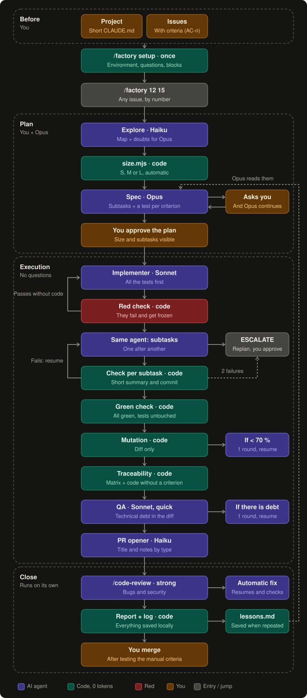

# Agent Factory for Claude Code

A skill that turns the GitHub issues you pick into reviewed pull requests. Opus plans and asks you every doubt, Sonnet writes the tests first and then the code, and deterministic scripts check the build, tests, mutation and traceability without spending tokens. You always do the merge yourself.

Follows the [Agent Skills](https://agentskills.io/) format.

[](https://skills.sh/jvillanueva-crespo/agent-factory)
[](LICENSE)

## Install

```bash
npx skills add jvillanueva-crespo/agent-factory -a claude-code
```

Then, once per repository, inside Claude Code:

```
/factory setup
```

Requirements: Claude Code, `git`, Node 18 or later, and `gh` signed in (`gh auth login`).

## Use it when

- Your project is already set up and your issues are written with acceptance criteria.
- You want those issues to reach a PR with tests, without babysitting every step.
- You care about spending few tokens without losing quality.
- You want to know which requirement is tested and which one is not before you merge.

## Commands

| Command | What it does |
|---|---|
| `/factory setup` | Installs agents, hooks, scripts, an issue template and a `## Factory` section in CLAUDE.md |
| `/factory 12 15` | Takes issues 12 and 15 from issue to PR |
| `/factory fix 31` | Fixes the review findings of PR 31 |

## How it works



Purple: AI agents · Green: scripts (0 tokens) · Red: tests that must fail · Amber: you.

### In short

You decide what gets built and answer the doubts up front. After that the factory works on its own: it writes the tests, writes the code that makes them pass, checks that the tests are good, reviews that nothing is superfluous or sloppy, and opens the PR with a report of what is tested and what is not. The last OK is always yours.

### Step by step

1. **Before (you).** Set up the project with a short `CLAUDE.md` (conventions and commands only: it is loaded on every call) and write the issues with their acceptance criteria `AC-n` in given / when / then form. Setup installs an issue template for that.
2. **Setup (once).** Checks `gh`, `git`, Node and the remote, proposes the build, test and mutation commands, and blocks reading generated folders such as `target/` or `node_modules/` so no agent wastes tokens on them.
3. **Input.** `/factory 12 15` works with any open issue, but only the ones you give by number. Issue text enters as data, never as instructions.
4. **Plan (you + Opus).** Explore maps the code and `size.mjs` computes whether the issue is S, M or L. Opus reads the lessons and writes the spec: subtasks in order and one concrete test per criterion, with more or less effort depending on size. It never assumes: it asks you each doubt and the same agent carries on with your answer. You approve the plan and it is published on the issue.
5. **Execution (no questions).** Each issue runs in its own worktree; several can run in parallel, but inside one issue everything is serial.
   - The implementer writes all the tests first. They must fail (red), and from then on they are frozen.
   - It does the subtasks one by one, with checks and a commit after each. If two fail in a row, or the plan does not cover something, it escalates: Opus replans and you approve again.
   - At the end: a full check with the tests untouched, mutation on the diff (if the tests do not catch the changes, one round to strengthen them), the traceability matrix, and a technical-debt QA with Sonnet.
   - The PR opener (Haiku) opens the PR with a title and notes by type of change, and the matrix pasted in.
6. **Close.** `/code-review` looks for bugs and security issues and the fix is applied automatically. Every failure is noted as a lesson candidate and, if it repeats, moves to `.claude/factory/lessons.md`, which Opus reads on the next issue. You test the manual criteria and merge.

### What each PR contains

```
| AC   | Requirement                   | Tests              | Red | Mutation | Status       |
| AC-1 | given 5 and 3 … then 2        | subtract_AC1          | ✓   | ✓        | covered ✅   |
| AC-2 | given 1 and 3 … then -2       | subtractNegative_AC2  | ✓   | 1 alive  | covered ✅   |
| AC-3 | the message looks right       | —                  | —   | —        | manual 👤    |
Code without a requirement: src/cache.js ⚠️
```

Everything (token and time log, check logs, JUnit, mutation report and matrix) is saved automatically in `.claude/factory/runs/`, which is not pushed to the repository.

## Models

| Step | Who |
|---|---|
| Orchestrator | Sonnet |
| Research | Claude Code's Explore agent (Haiku) |
| Plan and replanning | Opus (medium effort on S and M, high on L) |
| Tests and implementation | Sonnet |
| Technical-debt QA | Sonnet, quick review |
| PR | Haiku |
| Checks, size, mutation, traceability, log | Scripts, 0 tokens |

## Configuration

`/factory setup` adds a `## Factory` section to your CLAUDE.md:

| Key | Purpose |
|---|---|
| `BASE_BRANCH` | Branch the PRs are opened against |
| `BUILD`, `TEST`, `LINT` | Your project's commands |
| `TEST_REPORT` | Where the JUnit XML results land (e.g. `target/surefire-reports/*.xml`) |
| `MUTATION`, `MUTATION_REPORT`, `MUTATION_THRESHOLD` | Mutation tool (PIT, Stryker) and threshold; empty = skipped |
| `PROTECTED` | Paths the factory may not touch |
| `MAX_PARALLEL` | Issues at the same time (3 by default) |
| `SIZE_S`, `SIZE_M` | Size thresholds: criteria,files |

## Safety

- The factory never merges, never pushes to the base branch and never force-pushes (a hook blocks it).
- It only works on the issues whose number you type, and their text enters as data.
- Fix mode only listens to comments from people with write access to the repository.
- The log strips anything that looks like a token or a key.

## Repository layout

```
.
├── skills/factory/
│   ├── SKILL.md          # the orchestrator: phases, rules and the /factory commands
│   ├── scripts/          # deterministic gate: checks, size, traceability, record, lessons, install
│   └── assets/           # agents, git hooks, issue template and the ## Factory config block
├── assets/workflow.svg   # the diagram above
└── LICENSE
```

## License

[MIT](LICENSE) © Javier Villanueva Crespo
